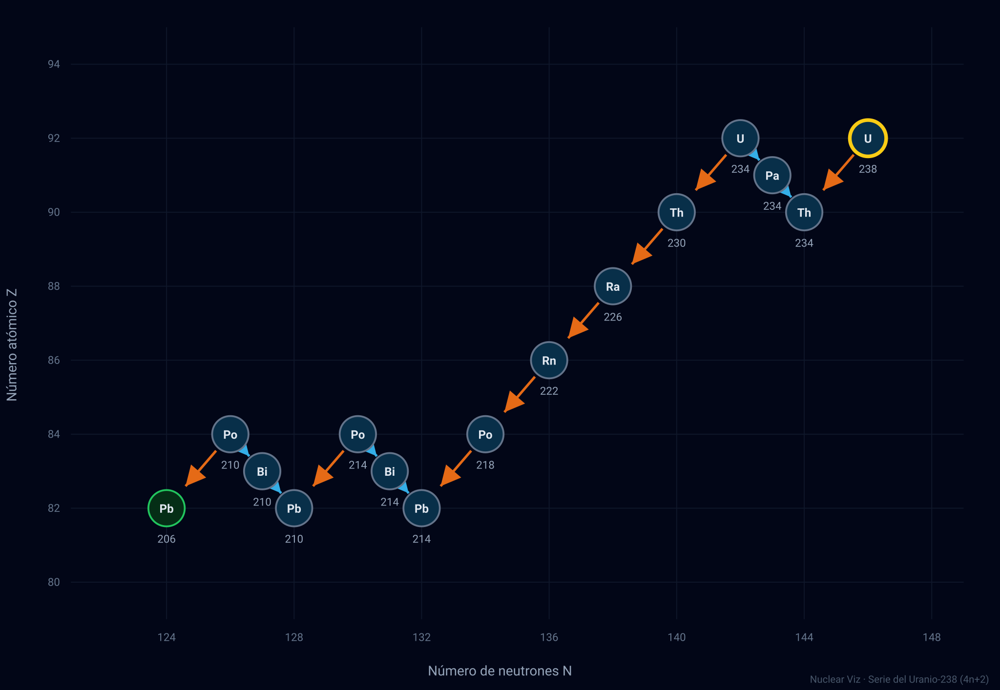
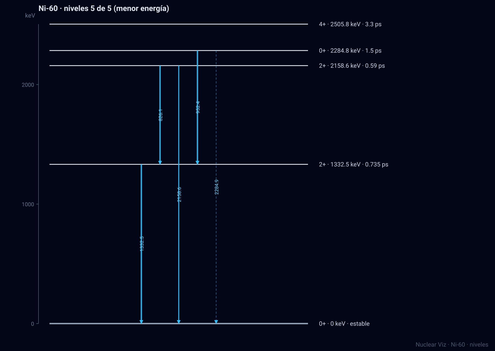

# ☢ Nuclear Viz

> «Tecnósfera al servicio de la Biósfera.» — «La Paz Es El Camino.»

Visualización educativa de física nuclear: cadenas de decaimiento, carta de núclidos y base para integrar ENSDF/EXFOR.

## 🌐 Live Demo

Demo estática: [https://amurlaniakea.github.io/nuclear-viz/](https://amurlaniakea.github.io/nuclear-viz/)

Usa datos pre-generados en `site/data/`. La búsqueda de núclidos y la consulta remota
(IAEA Livechart) necesitan el backend: ver [Ejecutar](#ejecutar).

*Ejemplo generado con el propio botón «Exportar SVG». Hay también ejemplos del
[Torio-232](docs/ejemplos/nuclear-viz-th232.svg) y del [Uranio-235](docs/ejemplos/nuclear-viz-u235.svg).*

## Qué incluye

- Cadenas naturales simplificadas:
  - Uranio-238 → Plomo-206
  - Torio-232 → Plomo-208
  - Uranio-235 → Plomo-207
- Carta interactiva N vs Z, con detalle de núclido, vida media y modos de decaimiento.
- Búsqueda de cualquier núclido (local o IAEA Livechart) desde la interfaz.
- Exportación del gráfico a SVG y PNG.
- API FastAPI lista para crecer hacia ENSDF/EXFOR.

## Cómo se usa

**Explorar una cadena.** Elige una de las tres series en el selector. Haz clic en un núclido
del gráfico o de la tabla para ver su detalle: Z/N/A, vida media, modos de decaimiento y
sus decaimientos salientes y entrantes.

**Buscar un núclido** (solo con el backend en marcha). Escribe en la caja «Buscar núclido»
cualquiera de estos formatos; todos equivalen a `Pb-214`: `Pb-214`, `pb214`, `214Pb`.
Los isómeros se escriben con `m` (`Pa-234m`, `99mTc`) y solo se resuelven si están en el dataset local.
Si el núclido pertenece a la cadena que estás viendo, se resalta en el gráfico; si no,
se muestra su ficha con la fuente (dataset local o IAEA Livechart).

**Esquema de niveles** (solo con el backend). En la ficha de un núclido, el botón «Ver esquema de niveles»
dibuja sus niveles de energía (los de menor energía; elige 10, 20, 40 u 80) y las transiciones gamma entre
ellos, con la intensidad relativa reflejada en el grosor de la flecha. Son los niveles del propio núclido:
para ver los gammas de un decaimiento, busca el núclido hijo (los de Co-60 están en Ni-60). Se puede
exportar a SVG.

*Ejemplo: los 5 primeros niveles del Ni-60, con las transiciones gamma de 1332 keV (E2) y 826 keV (M1+E2).*

**Exportar el gráfico.** Los botones «Exportar SVG» y «Exportar PNG» descargan la cadena
visible (por ejemplo `nuclear-viz-u238.svg`). El SVG es vectorial y autónomo, con fondo
oscuro; el PNG se genera al doble de resolución (2200×1520), útil para diapositivas.
Funcionan también en la demo estática.

## Requisitos

- Python 3.10 o superior
- python3-venv

En Debian/Ubuntu/WSL:

    sudo apt install python3-venv

## Ejecutar

    bash run.sh

Por defecto escucha solo en 127.0.0.1. Para exponerlo en la red local: `HOST=0.0.0.0 bash run.sh`.

Luego abrir:

    http://localhost:8000

## API

Con el servidor en marcha, la documentación interactiva está en `http://localhost:8000/docs`.

| Endpoint | Descripción |
|---|---|
| `GET /api/health` | Comprobación de estado. |
| `GET /api/chains` | Lista de cadenas disponibles. |
| `GET /api/chains/{chain_id}` | Núclidos y desintegraciones de una cadena (`u238`, `th232`, `u235`). |
| `GET /api/nuclide/{Símbolo-A}` | Ficha de un núclido, p. ej. `Pb-214` o `Pa-234m`. Busca primero en el dataset local; con `?force_remote=true` consulta IAEA Livechart aunque exista en local. |

`GET /api/nuclide/{Símbolo-A}/levels?max_levels=40` devuelve los `max_levels` niveles de menor energía
(5 a 100) y las transiciones gamma entre ellos, desde IAEA Livechart (ENSDF).

Códigos de error de `/api/nuclide`: `400` formato no válido, `404` núclido inexistente
(o isómero sin datos locales) y `502` si el servicio remoto no responde y no hay dato local.

## Tests

    ./.venv/bin/pytest
    ./.venv/bin/ruff check .

Algunos tests comprueban la lógica JavaScript con `node`; si no está instalado, se omiten.

## Estructura

- `backend/`: API FastAPI, cliente IAEA (`parsers/iaea.py`) y dataset local (`data/`).
- `site/`: frontend compartido (`app.js`, `nuclide-search.js`, `export.js`, `assets/`) y demo estática (`data/`).
- `backend/static/index.html`: página del modo servidor (usa los recursos de `site/`).
- `docs/ejemplos/`: gráficos de ejemplo exportados con la propia aplicación.
- `tests/`: pytest, con fixtures reales de respuestas de IAEA Livechart.

## Fuente de datos remota

Los núclidos que no están en el dataset local se consultan a la API pública de
[IAEA Livechart](https://nds.iaea.org/relnsd/vcharthtml/api_v0_guide.html) (datos ENSDF),
con caché en memoria de 1 h. Revisa sus condiciones de uso antes de redistribuir datos.

## Aviso

Los datos incluidos están simplificados con fines educativos.
No usar para protección radiológica ni cálculos de seguridad.

## Roadmap

- [ ] Parser/ingesta ENSDF.
- [ ] Consulta EXFOR.
- [x] Esquema de niveles y transiciones gamma (modo servidor, desde la ficha de búsqueda).
- [x] Búsqueda de núclidos (modo servidor: `Pb-214`, `214Pb`, `Pa-234m`).
- [x] Exportar SVG/PNG (botones sobre el gráfico; también en la demo estática).

## 📧 Contacto

- **Autor**: Pedro Sordo Martínez
- **e-mail**: amurlaniakea@gmail.com
- **Hugging Face**: [MagoPredator](https://huggingface.co/MagoPredator)

## Licencia

AGPL-3.0-or-later. Ver [`LICENSE`](LICENSE).

## Verificación

- `pytest` valida la API y las invariantes de los datos de decaimiento.
- Los datos incluidos están simplificados y acotados a fines educativos.
- No usar para protección radiológica ni cálculos de seguridad.